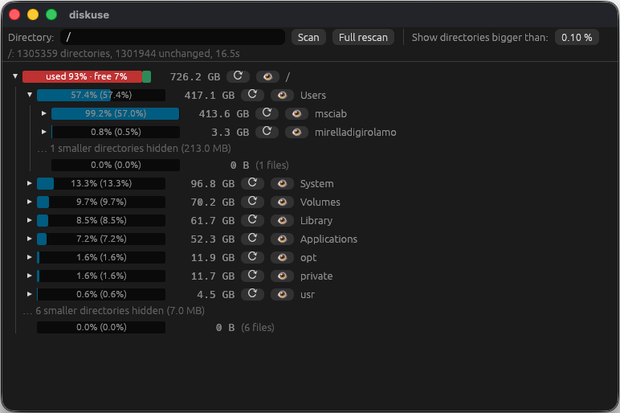

Vibe Coded app for checking space on mac.
Probably works also on other platforms, not tested.




Created with Claude and this prompt.

```
implement an utility to see the disk usage
use rust and egui

accepts a directory as arguments, defaultsu to /

scan recursively the sub directories

skip unreadable dirs

add a field "show directory bigger than", default 0.1 (%) and hide directories lower than threshold, if you specify 0 shows everything (put in the toolbar)

visualize as a tree and a show a bar on each node that  it shows the size of the subdirectory with a bar

start showing the top level always expanded but the children on the top level collapsed

you can expand the tree and see the subdirectories

you can refresh a single subdirectory without having to reload the whole tree

add a cache saving the sizes in ~/.diskuse.json with the timestamp of each directory
and use an optimized refresh updating only the directories with a changed timestamp

the top level and volume roots should not show "100%" but the occupied and free space  show volume roots with a split in different colors red/green (used y% fee y%)

an eye icon execute reveal in finder

the display should also display the relative and absolute percentage a folder use: relative% (absolute%)
```
